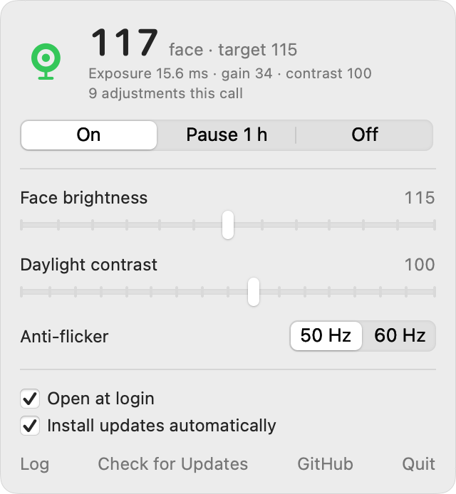

<div align="center">


<h1>WebcamBright</h1>

<p><strong>Auto exposure for your face, not for the window behind you.</strong><br/>
A small menu bar app for macOS that keeps a USB webcam exposed for your face during every call.</p>

<a href="https://github.com/estevecastells/webcam-bright/releases/latest/download/WebcamBright-macos-arm64.zip"></a>

<p>
<a href="https://github.com/estevecastells/webcam-bright/releases/latest"></a>

<a href="https://github.com/estevecastells/webcam-bright/actions/workflows/ci.yml"></a>
<a href="LICENSE"></a>
</p>

**Or install in one line** (no password, checksum verified):

</div>

```sh
curl -fsSL https://raw.githubusercontent.com/estevecastells/webcam-bright/main/scripts/get.sh | bash
```

<p align="center">
  <picture>
    <source media="(prefers-color-scheme: dark)" srcset="docs/images/panel-dark.png">
    
  </picture>
</p>

## Why

Sit with a bright window behind you and your face comes out almost black. The Logitech C920's auto exposure meters the whole picture, and the window is the brightest thing in it, so the camera turns the exposure down to save the window. With factory settings, skin measured 49 out of 255.

Fixed manual settings don't last, because the light changes through the day. WebcamBright measures your face instead, and keeps correcting for as long as the call lasts.

## What it does

- **Only acts during calls.** It never turns the camera on. When Zoom, Meet, FaceTime or any other app does, it joins that same camera and becomes its auto exposure.
- **Measures your face, not the scene.** Apple's on-device face detection finds your face twice a second, and the app steers brightness, exposure and gain until your skin sits at 115 out of 255.
- **Leaves the call alone.** The call app keeps its own resolution and 30 fps. WebcamBright looks at a separate copy, scaled to 640 px wide, at 4 frames a second.
- **Learns as it goes.** How much a step of gain brightens your face depends on the light, so the step size is learned live.
- **Shows what it's doing.** The menu shows your face brightness against the target and what the camera is set to, and the log records every adjustment.
- **Gives the camera back.** Pause it for an hour, turn it off or quit, and the camera goes back to its own auto exposure. After a call, the camera is free again within about 10 seconds.
- **Updates itself, never during a call.** New releases are checked, signature-verified and installed once the call is over. You can turn this off.

Tested on an Apple silicon Mac (M5 Pro) with macOS 27 and a Logitech C920. Other UVC webcams should work, but their exposure steps and useful gain range need measuring first: see [Other cameras](#other-cameras).

## Install

On an Apple silicon Mac with macOS 14 or later, run the one-line installer above. It downloads the latest release and checks its checksum, and also its build attestation if you have the GitHub CLI. Then it installs **WebcamBright.app** into `/Applications` and opens it. It appears in the menu bar and adds itself to Login Items, so it starts with your Mac.

Or [download the app](https://github.com/estevecastells/webcam-bright/releases/latest/download/WebcamBright-macos-arm64.zip), unzip it and move it to Applications. It is signed but not notarized, so the first time macOS may refuse to open it: go to **System Settings → Privacy & Security** and click **Open Anyway**. The installer doesn't need this, because `curl` downloads don't get the quarantine flag.

The first time a call turns the camera on, macOS asks whether WebcamBright may use the camera. Allow it. If the prompt doesn't show, the switch is in **System Settings → Privacy & Security → Camera**. Releases are all signed with the same certificate, so the permission survives updates.

**Uninstall:** quit WebcamBright from its menu, which hands the camera back to its own auto exposure, and move the app to the Trash. From a clone of this repository, `make uninstall` does both and also removes the login item.

**Upgrading from the background helper:** earlier versions ran as a LaunchAgent. The installer removes that agent for you. It stops if it finds a WebcamBright helper under another label, because two copies would fight over the camera.

### From source

You need Apple's command line tools. No full Xcode, no third-party dependencies. This is also the way to run it on an Intel Mac.

```sh
xcode-select --install          # only if you don't have the command line tools yet
git clone https://github.com/estevecastells/webcam-bright.git
cd webcam-bright
make install
```

`make install` builds the app, signs it and copies it to `/Applications` (or `~/Applications` if `/Applications` isn't writable), then opens it. Without a signing certificate it is signed ad hoc, and the signature changes with every build, so macOS asks for the camera again after each rebuild. `scripts/make-signing-cert.sh` creates a local certificate that avoids this.

## The menu

| | |
|---|---|
| **Header** | During a call: your face brightness, the target, and the camera's exposure, gain and contrast. Between calls: the last call's average and number of adjustments. |
| **On / Pause 1 h / Off** | Paused or off, the camera uses its own auto exposure. A pause ends by itself after an hour, and survives a restart. |
| **Face brightness** | How bright your skin should be, 0 to 255. 115 looked right in testing; raise it if you look dim, lower it if you look washed out. |
| **Daylight contrast** | Lower softens the shadows on your face. 100 by default, below the camera's own 128. In a room lit only by the screen it rises to 140 on its own. |
| **Anti-flicker** | Match your mains: 50 Hz in Europe and most of the world, 60 Hz in most of the Americas. The default follows your Mac's region. |
| **Install updates automatically** | On by default. WebcamBright checks GitHub for a new release 15 seconds after it starts and then every 6 hours, and installs it after the call if there is one. Off, the menu shows the update and waits for you. |
| **Log** | Opens `~/Library/Logs/webcam-bright.log`. Each adjustment is logged with the face brightness before it and the camera settings after it. |

**Quit** hands the camera back to its own auto exposure, so it isn't left on fixed settings for a call while WebcamBright isn't running.

To follow the log from a terminal: `make log`.

## Command line

`uvcctl` reads and changes the camera's controls directly, which is handy for trying values by hand. It is inside the app, at `/Applications/WebcamBright.app/Contents/Resources/uvcctl`, and at `build/uvcctl` after a build from source:

```sh
build/uvcctl list                         # every control: current, min, max, default
build/uvcctl set gain 20 brightness 140   # set one or more controls
build/uvcctl reset                        # factory defaults
```

`UVC_CAMERA=<part of name>` picks a camera when more than one is plugged in. During a call, WebcamBright will move exposure and gain again.

To calibrate the target against a photo, `/Applications/WebcamBright.app/Contents/MacOS/WebcamBright --measure photo.jpg` prints the skin area it measures as an ffmpeg crop filter.

<details>
<summary><b>How it works</b></summary>

```
idle ──(app turns camera on)──▶ call detected ──▶ measure & correct ◀──────┐
 ▲                                                (every 0.5 s)            │
 │                                                     │ every 6 s         │
 │                                                     ▼                   │
 └──(camera off: call ended)── release check (let go for 0.8 s) ─(still on)┘
```

**Detecting a call.** macOS has no public API that says which app is using the camera, and AVFoundation's `isInUseByAnotherApplication` never changes for this camera. CoreMediaIO's `kCMIODevicePropertyDeviceIsRunningSomewhere` does, but it also counts WebcamBright's own session. So every 6 seconds the app stops its session for 0.8 s and checks whether the camera is still running. If it is, the call goes on.

**Not disturbing the call.** Several apps can use a camera at once on macOS. While its session starts, the app holds the device's configuration lock with the current format set, so its session can't switch the camera to another resolution.

**Measuring.** A single `VNSequenceRequestHandler` finds the largest face. Skin brightness is the luma of the central part of the face box, above the mouth, read straight from the camera's native `420v` frames.

**Controlling.** The camera is driven over IOKit with plain UVC control requests ([`app/Sources/CUVC/uvc.c`](app/Sources/CUVC/uvc.c)), with no driver. Each measurement moves at most one lever ([`Levers.swift`](app/Sources/WebcamBrightKit/Levers.swift), checked by `make check` without a camera).

If the face is too dark:

1. Brightness back to neutral (128), if it was lowered.
2. Exposure one step longer, up to 15.6 ms, the longest that keeps 30 fps.
3. Gain up, to 100.
4. Low-light mode: 31.2 ms (about 25 fps), with 10 less gain so the picture doesn't jump. It ends as soon as the gain at 31.2 ms falls below 40.
5. Gain up again, to 100, the most that still helps.

If it is too bright, the other way round: less gain first, then brightness down in steps of 4 (to 80), then a shorter exposure. An exposure step that proved too dark during a call isn't tried again in that call, so the picture doesn't oscillate.

In daylight, contrast is 100, below the camera's default of 128, which softens the shadows on your face: 95 still looked natural in testing, 64 looked flat and grey. Saturation stays at 128. Only in a room lit by the screen alone, which looks grey and flat, do both rise to 140, as the gain needed at 15.6 ms goes from 60 to 100.

**Letting go.** Paused, off or quit, the app sets gain, brightness, contrast, saturation and backlight compensation back to the camera's own defaults and turns the camera's auto exposure back on. Anti-flicker stays as you set it.

**One copy at a time.** If another WebcamBright is running, such as an older background helper, the app leaves the camera to it and says so in the menu.

</details>

## What we learned

Most of the work was measuring. None of this is documented anywhere, so it may save you hours.

### Logitech C920

| What it does | What WebcamBright does about it |
|---|---|
| Exposure only takes 0.3 / 0.9 / 1.9 / 3.9 / 7.8 / 15.6 / 31.2 ms; any other value falls back to 15.6 ms | A fixed ladder of those seven values |
| From 3.9 ms up the camera evens the picture out itself, so exposure barely changes brightness: going from 15.6 to 31.2 ms is worth about 13 gain units | Exposure is the coarse lever; gain is the fine one |
| 31.2 ms drops the video to about 25 fps; 15.6 ms keeps 30 fps | 31.2 ms only in low-light mode, as a last resort, left as soon as there is enough light |
| One gain unit moves the face by 4.6, 0.75 or 0.5, depending on the light | The step size is learned live |
| Above gain 100 the picture gets darker (160 is darker than 100) | Gain tops out at 100 |
| In daylight the default contrast (128) deepens face shadows; 100 softens them and still looks natural, 64 looks flat and grey | Contrast 100 in daylight |
| In a room lit only by the screen, contrast and saturation at 140 look less grey | Both rise to 140 as the room gets darker |

### macOS

| What happens | What WebcamBright does about it |
|---|---|
| Several apps can use the camera at once | The app opens its own session without interrupting the call |
| AVFoundation's `isInUseByAnotherApplication` never changes for this camera | Calls are detected with CoreMediaIO's `kCMIODevicePropertyDeviceIsRunningSomewhere` |
| No public API says which app is using the camera, and the app's own session counts too | Every 6 s it lets go for 0.8 s and checks whether the camera is still on |
| macOS has no `.inputPriority` preset, and a second session can change the call's resolution | Hold the configuration lock and re-assign `activeFormat` while starting |
| The 30 fps formats are `420v`; `yuvs` gives 5–10 fps at 720p and 1080p | Always ask for `420v` |
| A new `VNImageRequestHandler` per frame recompiles the face model: 31 % CPU | One `VNSequenceRequestHandler` for the whole run |
| App Nap stalls a background app's timers | `beginActivity` and `LSAppNapIsDisabled` |
| Camera permission is per app, and a bare binary can't ask for it | A `.app` bundle with `NSCameraUsageDescription`, signed ad hoc |

## Performance

Measured on an M5 Pro with a 720p call, with `top` (3-second samples) and `footprint`:

| | CPU | Memory | Call video |
|---|---|---|---|
| Before the first call | 0 % | ~19 MB | — |
| During a call | 10–25 % of one core, 16 % on average | ~150 MB | 30.0 fps, no dropped frames |
| During a call in low-light mode | not measured again | not measured again | ~25 fps |
| After a call | 0 % | ~84 MB (the face model stays loaded) | — |

After a sudden change of light, such as a lamp switched on or off, your face is back on target in 1–4 s.

## Limitations

- **It can't make light.** In a room lit only by the screen, the result depends on what the screen shows. With light content the face reached the target at 30 fps; with dark content it stayed around 50 (target 115), even at 31.2 ms and gain 100. A lamp in front of you, a brighter screen or Night Shift turned off is what helps. A 62.5 ms exposure would add a little, but it caps the video at 16 fps, so it isn't used.
- **It doesn't remove backlight.** A window behind you stays blown out so that your face looks right, which is the right trade in a call.
- **It can't move shadows.** Shadows on your face come from the direction of the light. The lower daylight contrast softens them, but exposure can't remove them. macOS's [Edge Light](https://support.apple.com/en-us/125934) (macOS 26.2 or later on Apple silicon, works with external cameras) lights your face from the edges of the screen, and pairs well with WebcamBright.
- **Measured on one camera.** Other models need their own exposure ladder and gain range.

## Other cameras

1. Run `make build` and then `build/uvcctl list`, and note part of the name on its first line. Tell WebcamBright with `defaults write io.github.estevecastells.webcam-bright cameraName "<part of the name>"`, then quit and reopen the app.
2. Switch to manual exposure with `build/uvcctl set ae-mode 1`, then try exposure values with `build/uvcctl set exposure <value>`. Values the camera doesn't honour come back changed in `build/uvcctl list`. Put the ones it keeps in `exposureLadder` in [`Tuning.swift`](app/Sources/WebcamBrightKit/Tuning.swift).
3. Check the frame rate at each exposure. `normalTopRung` is the longest one that still gives 30 fps.
4. Raise `gain` while watching the picture and note where it stops getting brighter: that's `maxGain`.
5. `make install` again.

Measured values for other cameras are the most useful contribution. See [CONTRIBUTING.md](CONTRIBUTING.md).

## License

[MIT](LICENSE). Not affiliated with Logitech or Apple.
